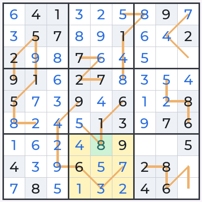

<!-- Written by tools/walkthrough.py entropic-lines: edit the script, not this page. -->
# Entropic Lines, step 45: the 8 in box 8

**Step 45 of 51** · [← Step 44](step-44.md) · [All steps](../entropic-lines.md#the-whole-puzzle-step-by-step) · [Step 46 →](step-46.md)

Box 8 needs an 8, and r7c5 is its last empty cell: **r7c5 = 8**.

**Step 45 of 51** · [← Step 44](step-44.md) · [All steps](../entropic-lines.md#the-whole-puzzle-step-by-step) · [Step 46 →](step-46.md)
