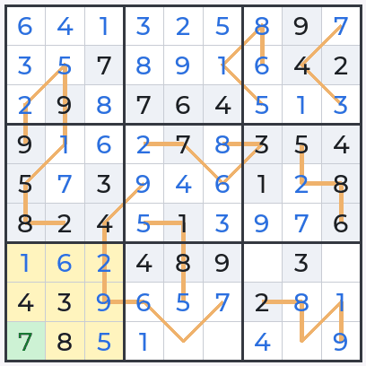

<!-- Written by tools/walkthrough.py entropic-lines: edit the script, not this page. -->
# Entropic Lines, step 46: the 1 in box 9

**Step 46 of 51** · [← Step 45](step-45.md) · [All steps](../entropic-lines.md#the-whole-puzzle-step-by-step) · [Step 47 →](step-47.md)

Box 9 needs a 1. r7c7 and r7c8: row 7 has one (r7c1). r9c9: row 9 has one (r9c4). Only **r8c9** is left: **r8c9 = 1**.

**Step 46 of 51** · [← Step 45](step-45.md) · [All steps](../entropic-lines.md#the-whole-puzzle-step-by-step) · [Step 47 →](step-47.md)
