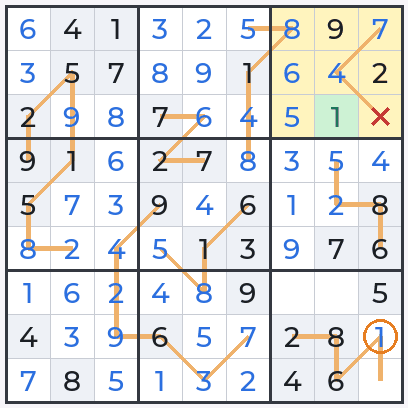

<!-- Written by tools/walkthrough.py entropic-lines: edit the script, not this page. -->
# Entropic Lines, step 47: the 1 in box 3

**Step 47 of 51** · [← Step 46](step-46.md) · [All steps](../entropic-lines.md#the-whole-puzzle-step-by-step) · [Step 48 →](step-48.md)

Box 3 needs a 1. r3c9: column 9 has one (r8c9). Only **r3c8** is left: **r3c8 = 1**.

**Step 47 of 51** · [← Step 46](step-46.md) · [All steps](../entropic-lines.md#the-whole-puzzle-step-by-step) · [Step 48 →](step-48.md)
