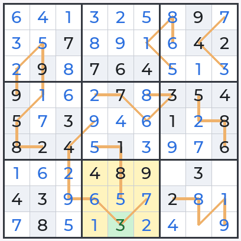

<!-- Written by tools/walkthrough.py entropic-lines: edit the script, not this page. -->
# Entropic Lines, step 48: the 3 in box 3

**Step 48 of 51** · [← Step 47](step-47.md) · [All steps](../entropic-lines.md#the-whole-puzzle-step-by-step) · [Step 49 →](step-49.md)

Box 3 needs a 3, and r3c9 is its last empty cell: **r3c9 = 3**.

**Step 48 of 51** · [← Step 47](step-47.md) · [All steps](../entropic-lines.md#the-whole-puzzle-step-by-step) · [Step 49 →](step-49.md)
