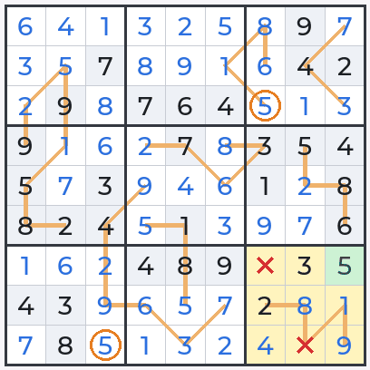

<!-- Written by tools/walkthrough.py entropic-lines: edit the script, not this page. -->
# Entropic Lines, step 49: the 3 in box 9

**Step 49 of 51** · [← Step 48](step-48.md) · [All steps](../entropic-lines.md#the-whole-puzzle-step-by-step) · [Step 50 →](step-50.md)

Box 9 needs a 3. r7c7: column 7 has one (r4c7). r9c9: row 9 has one (r9c5). Only **r7c8** is left: **r7c8 = 3**.

**Step 49 of 51** · [← Step 48](step-48.md) · [All steps](../entropic-lines.md#the-whole-puzzle-step-by-step) · [Step 50 →](step-50.md)
