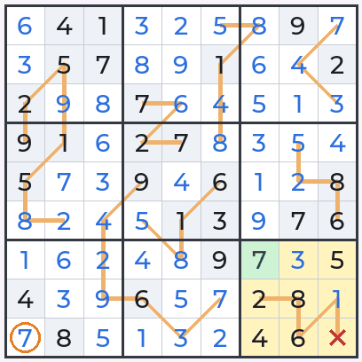

<!-- Written by tools/walkthrough.py entropic-lines: edit the script, not this page. -->
# Entropic Lines, step 50: the 7 in box 9

**Step 50 of 51** · [← Step 49](step-49.md) · [All steps](../entropic-lines.md#the-whole-puzzle-step-by-step) · [Step 51 →](step-51.md)

Box 9 needs a 7. r9c9: row 9 has one (r9c1). Only **r7c7** is left: **r7c7 = 7**.

**Step 50 of 51** · [← Step 49](step-49.md) · [All steps](../entropic-lines.md#the-whole-puzzle-step-by-step) · [Step 51 →](step-51.md)
