# Even-Odd

[← All variants](README.md) · [Puzzles](../features-puzzles.md) · [How to play](../how-to-play.md)

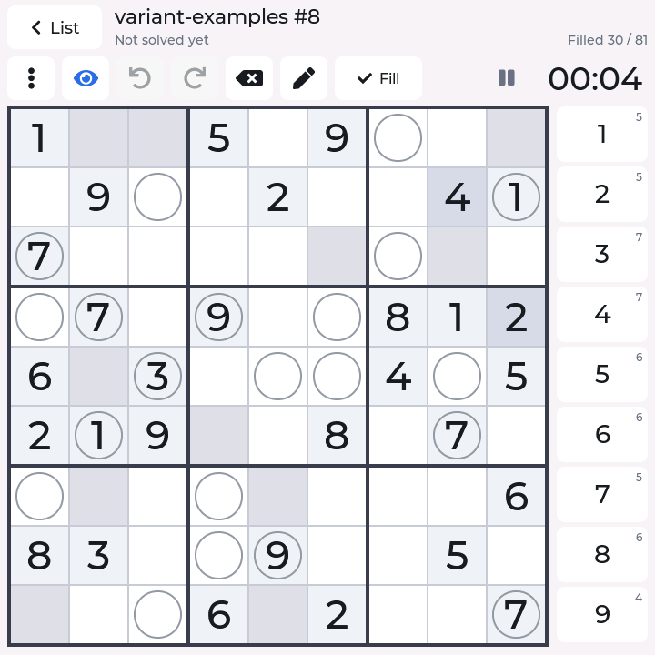

## The rules

[Classic](classic.md) rules, and some cells are marked: a **shaded** cell holds an **even** digit (2, 4, 6 or 8), a cell with a **ring** holds an **odd** one (1, 3, 5, 7 or 9). Unmarked cells can hold either.

## On the board

- About a third of the cells are marked: shaded for even, a grey ring for odd (a given can be marked too).
- A digit of the wrong kind turns red at once.
- **Puzzles → ⋮ → New puzzle → Even-Odd**.

## How to solve it

- A mark halves a cell's possibilities. Whenever the Classic rules leave a cell with two or three candidates, check its mark: it often leaves one.
- Count by kind in a unit: a row has four even and five odd digits. If a row's even digits are all placed, every empty cell in it is odd, marked or not.
- For hidden singles, an odd digit can't go in a shaded cell: those cells drop out of the search for 1, 3, 5, 7 and 9.

## Worked example

**variant-examples #8**, Even-Odd Easy (see [Classic](classic.md#worked-example) for how to import the examples; cells are written r*row*c*column*). The marks are in the screenshot.

```
1 . . | 5 . 9 | . . .
. 9 . | . 2 . | . 4 1
7 . . | . . . | . . .
------+-------+------
. 7 . | 9 . . | 8 1 2
6 . 3 | . . . | 4 . 5
2 1 9 | . . 8 | . 7 .
------+-------+------
. . . | . . . | . . 6
8 3 . | . 9 . | . 5 .
. . . | 6 . 2 | . . 7
```

**Step 1: r1c9, a shaded (even) cell.** Row 1 has 1, 5 and 9; column 9 has 1, 2, 5, 6 and 7; box 3 has 4 and 1. That leaves 3 and 8, and the cell is even. **r1c9 = 8**.

**Step 2: r2c3, a ringed (odd) cell.** Row 2 has 9, 2, 4 and 1; column 3 has 3 and 9; box 1 has 1, 9 and 7. That leaves 5, 6 and 8, and the cell is odd. **r2c3 = 5**.

**Step 3: r6c4, a shaded (even) cell.** Row 6 has 2, 1, 9, 8 and 7; column 4 has 5, 9 and 6; box 5 has 9 and 8. That leaves 3 and 4, and the cell is even. **r6c4 = 4**.

The pattern is the same each time: the Classic rules narrow a cell to two or three digits, and its mark picks one.

## The whole puzzle, step by step

<!-- walkthrough -->
<!-- Written by tools/walkthrough.py even-odd: edit the script, not this part. -->

The whole puzzle, from the start to the last cell: 51 steps, each one a single (one place left for a digit, or one digit left for a cell), taken in the order a box's single comes first, so not quite the order of the worked example above. In each picture, the unit the step looks at is tinted yellow (for a cell with one digit left: its row, column and box), the new digit is on green, the digits that rule cells out have an **orange ring**, and the empty cells they rule out a **red cross**. Givens are on grey, digits from earlier steps in blue.

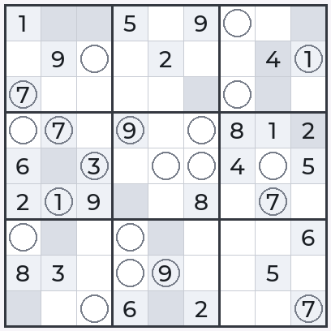

#### Step 1: the 3 in box 1

Box 1 needs a 3. r1c2 and r3c2: column 2 has one (r8c2). r1c3, r2c3 and r3c3: column 3 has one (r5c3). Only **r2c1** is left: **r2c1 = 3**.

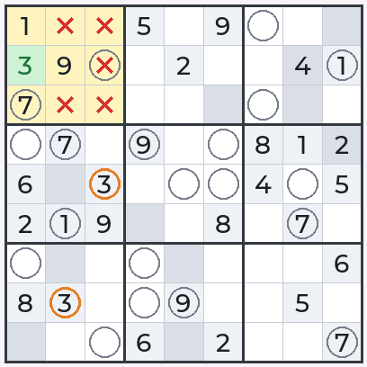

#### Step 2: the 4 in box 4

Box 4 needs a 4. r4c1: ringed (odd), so not 4. r5c2: row 5 has one (r5c7). Only **r4c3** is left: **r4c3 = 4**.

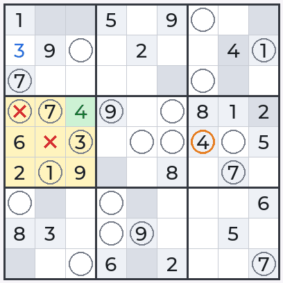

#### Step 3: the 5 in box 4

Box 4 needs a 5. r5c2: row 5 has one (r5c9). Only **r4c1** is left: **r4c1 = 5**.

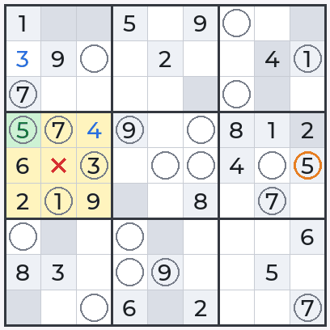

#### Step 4: the 8 in box 4

Box 4 needs an 8, and r5c2 is its last empty cell: **r5c2 = 8**.

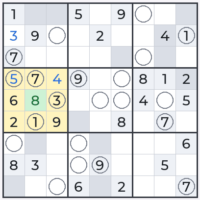

#### Step 5: the 2 in box 5

Box 5 needs a 2. r4c5 and r4c6: row 4 has one (r4c9). r5c5: column 5 has one (r2c5). r5c6: column 6 has one (r9c6). r6c4 and r6c5: row 6 has one (r6c1). Only **r5c4** is left: **r5c4 = 2**.

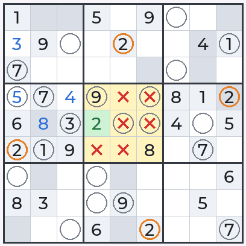

#### Step 6: the 5 in box 5

Box 5 needs a 5. r4c5 and r4c6: row 4 has one (r4c1). r5c5 and r5c6: row 5 has one (r5c9). r6c4: column 4 has one (r1c4). Only **r6c5** is left: **r6c5 = 5**.

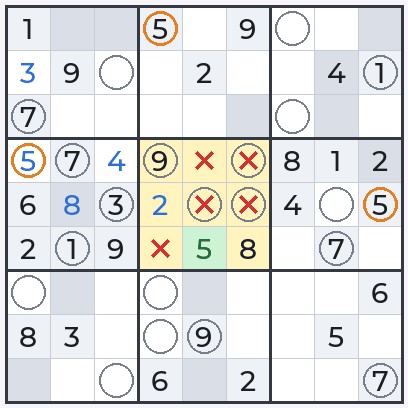

#### Step 7: the 4 in box 5

Box 5 needs a 4. r4c5 and r4c6: row 4 has one (r4c3). r5c5 and r5c6: row 5 has one (r5c7). Only **r6c4** is left: **r6c4 = 4**.

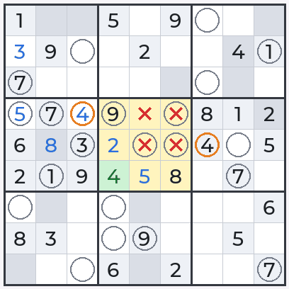

#### Step 8: the 6 in box 5

Box 5 needs a 6. r4c6: ringed (odd), so not 6. r5c5 and r5c6: row 5 has one (r5c1). Only **r4c5** is left: **r4c5 = 6**.

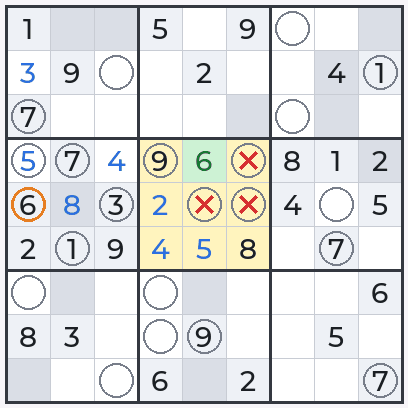

#### Step 9: the 3 in box 5

Box 5 needs a 3. r5c5 and r5c6: row 5 has one (r5c3). Only **r4c6** is left: **r4c6 = 3**.

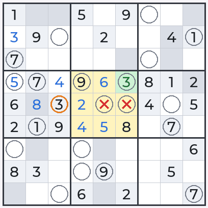

#### Step 10: the 6 in box 6

Box 6 needs a 6. r5c8: row 5 has one (r5c1). r6c9: column 9 has one (r7c9). Only **r6c7** is left: **r6c7 = 6**.

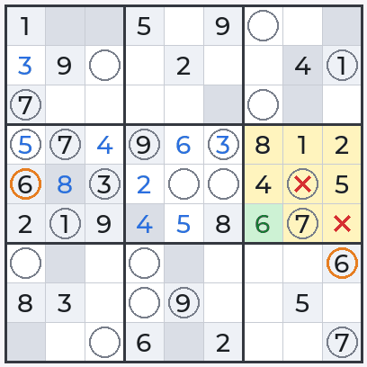

#### Step 11: the 3 in box 6

Box 6 needs a 3. r5c8: row 5 has one (r5c3). Only **r6c9** is left: **r6c9 = 3**.

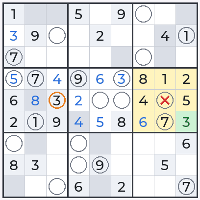

#### Step 12: the 9 in box 6

Box 6 needs a 9, and r5c8 is its last empty cell: **r5c8 = 9**.

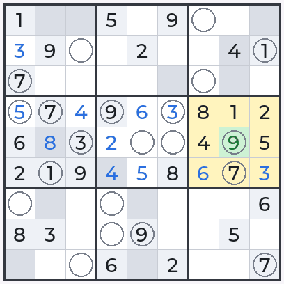

#### Step 13: the 6 in box 7

Box 7 needs a 6. r7c1, r7c2 and r7c3: row 7 has one (r7c9). r9c1, r9c2 and r9c3: row 9 has one (r9c4). Only **r8c3** is left: **r8c3 = 6**.

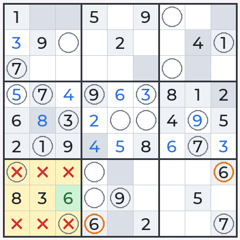

#### Step 14: the 7 in box 7

Box 7 needs a 7. r7c1: column 1 has one (r3c1). r7c2: column 2 has one (r4c2). r9c1, r9c2 and r9c3: row 9 has one (r9c9). Only **r7c3** is left: **r7c3 = 7**.

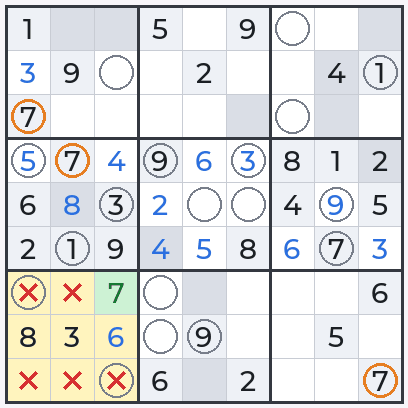

#### Step 15: the 1 in box 7

Box 7 needs a 1. r7c1 and r9c1: column 1 has one (r1c1). r7c2 and r9c2: column 2 has one (r6c2). Only **r9c3** is left: **r9c3 = 1**.

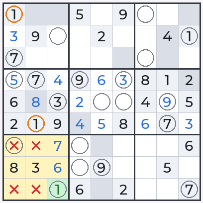

#### Step 16: the 2 in box 7

Box 7 needs a 2. r7c1: column 1 has one (r6c1). r9c1 and r9c2: row 9 has one (r9c6). Only **r7c2** is left: **r7c2 = 2**.

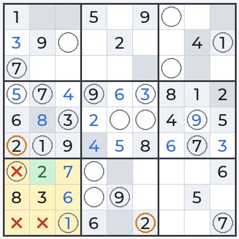

#### Step 17: the 5 in box 7

Box 7 needs a 5. r7c1 and r9c1: column 1 has one (r4c1). Only **r9c2** is left: **r9c2 = 5**.

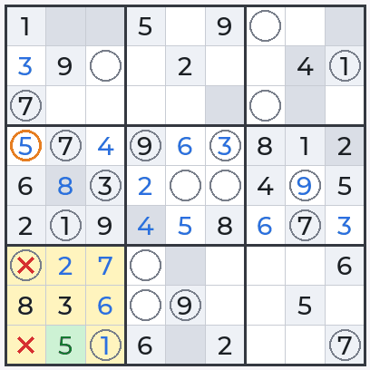

#### Step 18: the 4 in box 7

Box 7 needs a 4. r7c1: ringed (odd), so not 4. Only **r9c1** is left: **r9c1 = 4**.

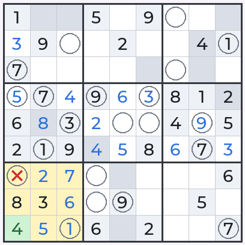

#### Step 19: the 9 in box 7

Box 7 needs a 9, and r7c1 is its last empty cell: **r7c1 = 9**.

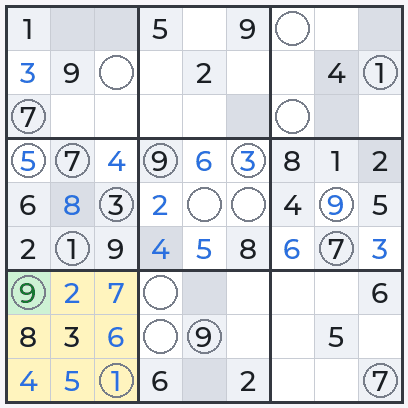

#### Step 20: the 3 in box 8

Box 8 needs a 3. r7c5 and r9c5: shaded (even), so not 3. r7c6: column 6 has one (r4c6). r8c4 and r8c6: row 8 has one (r8c2). Only **r7c4** is left: **r7c4 = 3**.

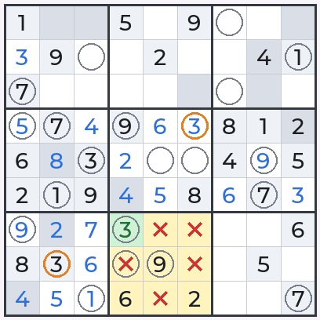

#### Step 21: the 5 in box 8

Box 8 needs a 5. r7c5: column 5 has one (r6c5). r8c4 and r8c6: row 8 has one (r8c8). r9c5: row 9 has one (r9c2). Only **r7c6** is left: **r7c6 = 5**.

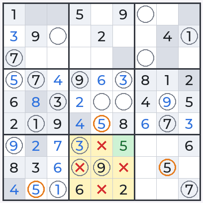

#### Step 22: the 2 in box 9

Box 9 needs a 2. r7c7 and r7c8: row 7 has one (r7c2). r8c9: column 9 has one (r4c9). r9c7 and r9c8: row 9 has one (r9c6). Only **r8c7** is left: **r8c7 = 2**.

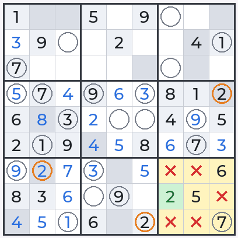

#### Step 23: the 1 in box 9

Box 9 needs a 1. r7c8: column 8 has one (r4c8). r8c9: column 9 has one (r2c9). r9c7 and r9c8: row 9 has one (r9c3). Only **r7c7** is left: **r7c7 = 1**.

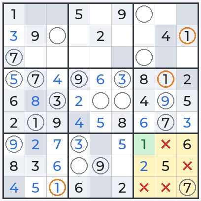

#### Step 24: the 4 in box 9

Box 9 needs a 4. r7c8: column 8 has one (r2c8). r9c7 and r9c8: row 9 has one (r9c1). Only **r8c9** is left: **r8c9 = 4**.

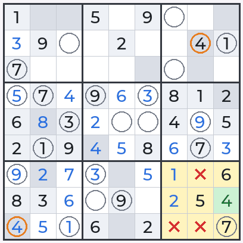

#### Step 25: the 4 in box 8

Box 8 needs a 4. r8c4 and r8c6: row 8 has one (r8c9). r9c5: row 9 has one (r9c1). Only **r7c5** is left: **r7c5 = 4**.

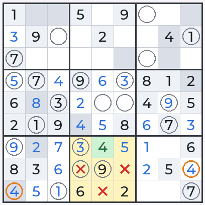

#### Step 26: the 4 in box 2

Box 2 needs a 4. r1c5 and r3c5: column 5 has one (r7c5). r2c4 and r2c6: row 2 has one (r2c8). r3c4: column 4 has one (r6c4). Only **r3c6** is left: **r3c6 = 4**.

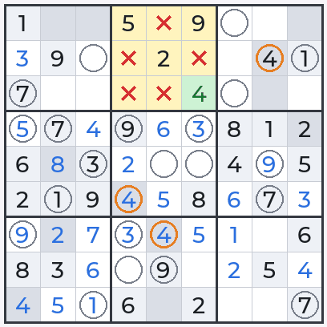

#### Step 27: the 4 in box 1

Box 1 needs a 4. r1c3: column 3 has one (r4c3). r2c3: row 2 has one (r2c8). r3c2 and r3c3: row 3 has one (r3c6). Only **r1c2** is left: **r1c2 = 4**.

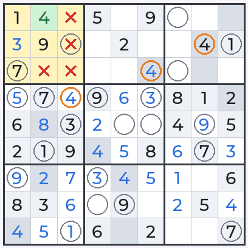

#### Step 28: the 6 in box 1

Box 1 needs a 6. r1c3, r2c3 and r3c3: column 3 has one (r8c3). Only **r3c2** is left: **r3c2 = 6**.

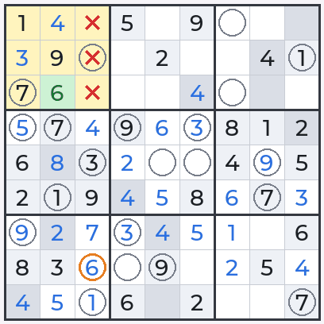

#### Step 29: the 6 in box 2

Box 2 needs a 6. r1c5: column 5 has one (r4c5). r2c4: column 4 has one (r9c4). r3c4 and r3c5: row 3 has one (r3c2). Only **r2c6** is left: **r2c6 = 6**.

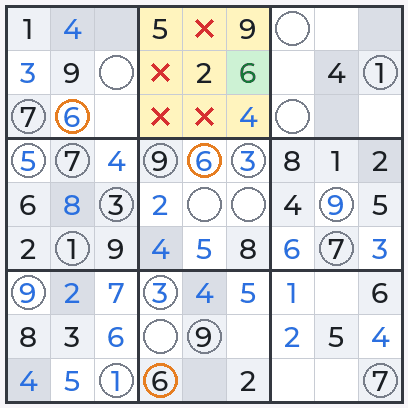

#### Step 30: the 6 in box 3

Box 3 needs a 6. r1c7: column 7 has one (r6c7). r1c9: column 9 has one (r7c9). r2c7: row 2 has one (r2c6). r3c7, r3c8 and r3c9: row 3 has one (r3c2). Only **r1c8** is left: **r1c8 = 6**.

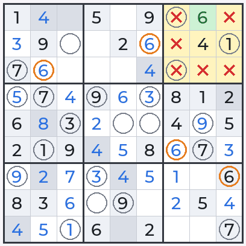

#### Step 31: the 2 in box 3

Box 3 needs a 2. r1c7 and r3c7: column 7 has one (r8c7). r1c9 and r3c9: column 9 has one (r4c9). r2c7: row 2 has one (r2c5). Only **r3c8** is left: **r3c8 = 2**.

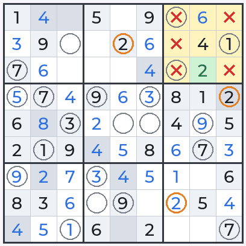

#### Step 32: the 2 in box 1

Box 1 needs a 2. r2c3: row 2 has one (r2c5). r3c3: row 3 has one (r3c8). Only **r1c3** is left: **r1c3 = 2**.

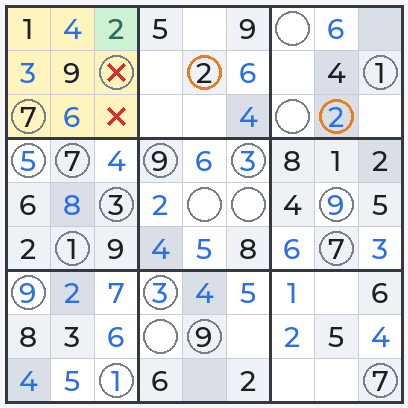

#### Step 33: the 8 in box 1

Box 1 needs an 8. r2c3: ringed (odd), so not 8. Only **r3c3** is left: **r3c3 = 8**.

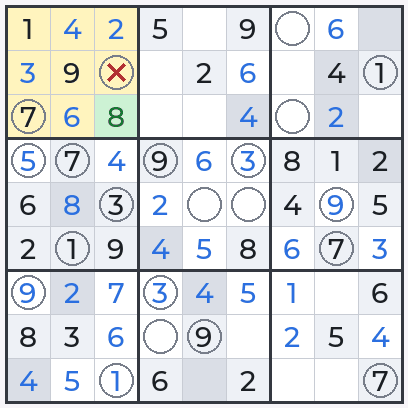

#### Step 34: the 5 in box 1

Box 1 needs a 5, and r2c3 is its last empty cell: **r2c3 = 5**.

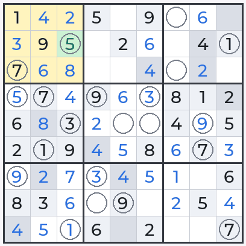

#### Step 35: the 5 in box 3

Box 3 needs a 5. r1c7 and r1c9: row 1 has one (r1c4). r2c7: row 2 has one (r2c3). r3c9: column 9 has one (r5c9). Only **r3c7** is left: **r3c7 = 5**.

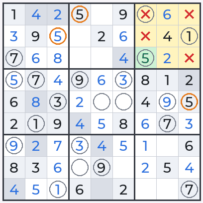

#### Step 36: the 3 in box 3

Box 3 needs a 3. r1c9 and r3c9: column 9 has one (r6c9). r2c7: row 2 has one (r2c1). Only **r1c7** is left: **r1c7 = 3**.

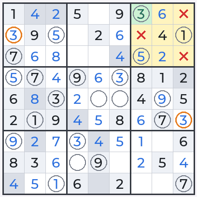

#### Step 37: the 3 in box 2

Box 2 needs a 3. r1c5: row 1 has one (r1c7). r2c4: row 2 has one (r2c1). r3c4: column 4 has one (r7c4). Only **r3c5** is left: **r3c5 = 3**.

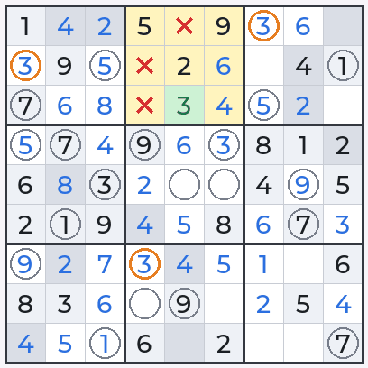

#### Step 38: the 1 in box 2

Box 2 needs a 1. r1c5: row 1 has one (r1c1). r2c4: row 2 has one (r2c9). Only **r3c4** is left: **r3c4 = 1**.

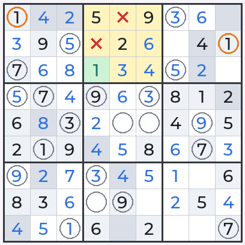

#### Step 39: the 7 in box 3

Box 3 needs a 7. r1c9: column 9 has one (r9c9). r3c9: row 3 has one (r3c1). Only **r2c7** is left: **r2c7 = 7**.

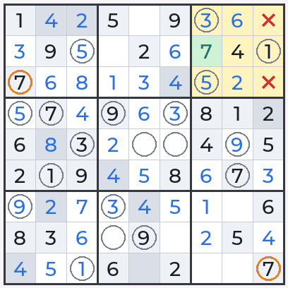

#### Step 40: the 7 in box 2

Box 2 needs a 7. r2c4: row 2 has one (r2c7). Only **r1c5** is left: **r1c5 = 7**.

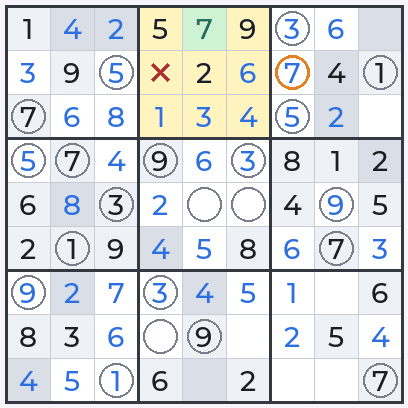

#### Step 41: the 8 in box 2

Box 2 needs an 8, and r2c4 is its last empty cell: **r2c4 = 8**.

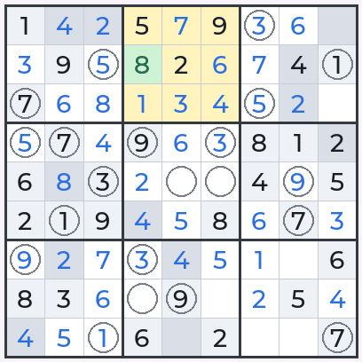

#### Step 42: the 8 in box 3

Box 3 needs an 8. r3c9: row 3 has one (r3c3). Only **r1c9** is left: **r1c9 = 8**.

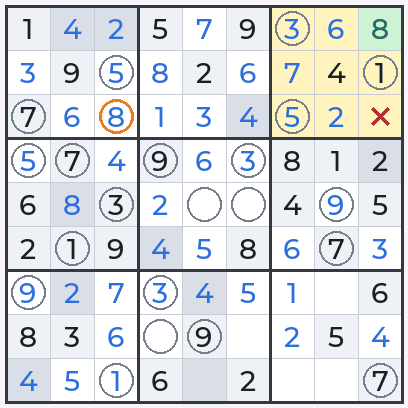

#### Step 43: the 9 in box 3

Box 3 needs a 9, and r3c9 is its last empty cell: **r3c9 = 9**.

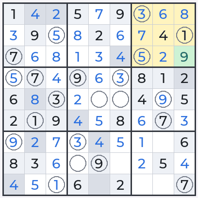

#### Step 44: the 7 in box 5

Box 5 needs a 7. r5c5: column 5 has one (r1c5). Only **r5c6** is left: **r5c6 = 7**.

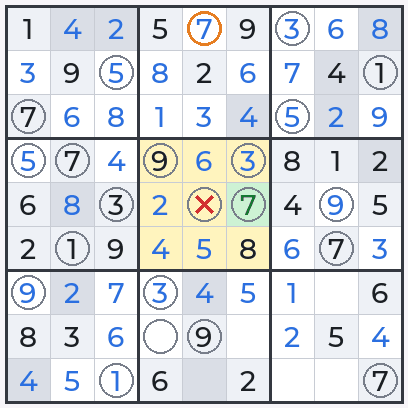

#### Step 45: the 1 in box 5

Box 5 needs a 1, and r5c5 is its last empty cell: **r5c5 = 1**.

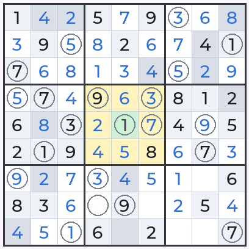

#### Step 46: the 1 in box 8

Box 8 needs a 1. r8c4: column 4 has one (r3c4). r9c5: row 9 has one (r9c3). Only **r8c6** is left: **r8c6 = 1**.

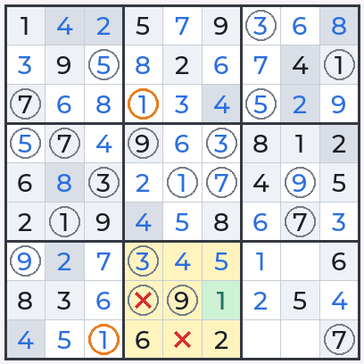

#### Step 47: the 7 in box 8

Box 8 needs a 7. r9c5: row 9 has one (r9c9). Only **r8c4** is left: **r8c4 = 7**.

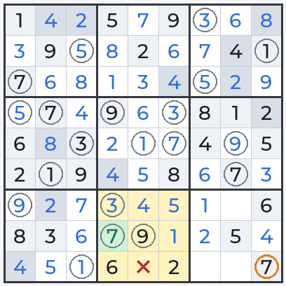

#### Step 48: the 8 in box 8

Box 8 needs an 8, and r9c5 is its last empty cell: **r9c5 = 8**.

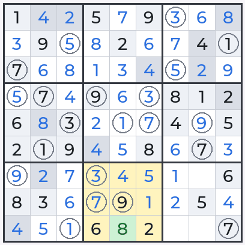

#### Step 49: the 3 in box 9

Box 9 needs a 3. r7c8: row 7 has one (r7c4). r9c7: column 7 has one (r1c7). Only **r9c8** is left: **r9c8 = 3**.


#### Step 50: the 8 in box 9

Box 9 needs an 8. r9c7: row 9 has one (r9c5). Only **r7c8** is left: **r7c8 = 8**.


#### Step 51: the 9 in box 9

Box 9 needs a 9, and r9c7 is its last empty cell: **r9c7 = 9**.


Solved.

<!-- /walkthrough -->
