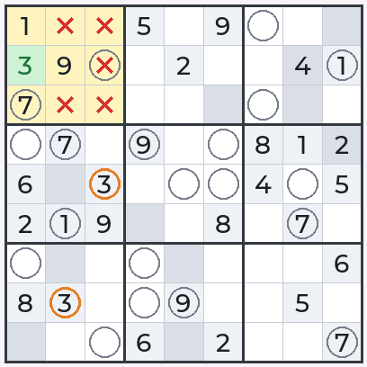

<!-- Written by tools/walkthrough.py even-odd: edit the script, not this page. -->
# Even-Odd, step 1: the 3 in box 1

**Step 1 of 51** · [← The start](../even-odd.md#the-whole-puzzle-step-by-step) · [All steps](../even-odd.md#the-whole-puzzle-step-by-step) · [Step 2 →](step-02.md)

Box 1 needs a 3. r1c2 and r3c2: column 2 has one (r8c2). r1c3, r2c3 and r3c3: column 3 has one (r5c3). Only **r2c1** is left: **r2c1 = 3**.

**Step 1 of 51** · [← The start](../even-odd.md#the-whole-puzzle-step-by-step) · [All steps](../even-odd.md#the-whole-puzzle-step-by-step) · [Step 2 →](step-02.md)
