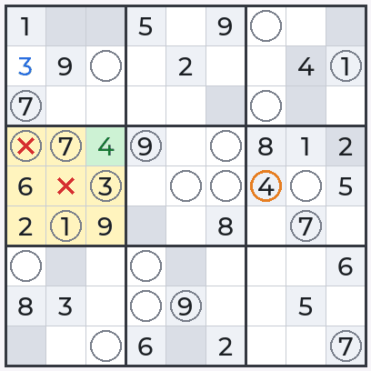

<!-- Written by tools/walkthrough.py even-odd: edit the script, not this page. -->
# Even-Odd, step 2: the 4 in box 4

**Step 2 of 51** · [← Step 1](step-01.md) · [All steps](../even-odd.md#the-whole-puzzle-step-by-step) · [Step 3 →](step-03.md)

Box 4 needs a 4. r4c1: ringed (odd), so not 4. r5c2: row 5 has one (r5c7). Only **r4c3** is left: **r4c3 = 4**.

**Step 2 of 51** · [← Step 1](step-01.md) · [All steps](../even-odd.md#the-whole-puzzle-step-by-step) · [Step 3 →](step-03.md)
