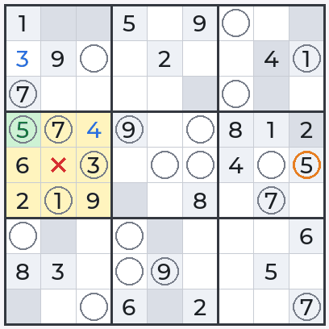

<!-- Written by tools/walkthrough.py even-odd: edit the script, not this page. -->
# Even-Odd, step 3: the 5 in box 4

**Step 3 of 51** · [← Step 2](step-02.md) · [All steps](../even-odd.md#the-whole-puzzle-step-by-step) · [Step 4 →](step-04.md)

Box 4 needs a 5. r5c2: row 5 has one (r5c9). Only **r4c1** is left: **r4c1 = 5**.

**Step 3 of 51** · [← Step 2](step-02.md) · [All steps](../even-odd.md#the-whole-puzzle-step-by-step) · [Step 4 →](step-04.md)
