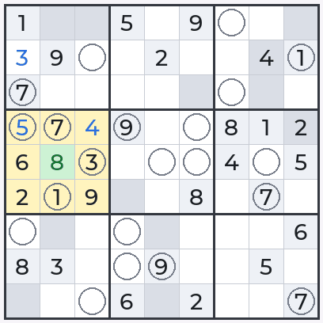

<!-- Written by tools/walkthrough.py even-odd: edit the script, not this page. -->
# Even-Odd, step 4: the 8 in box 4

**Step 4 of 51** · [← Step 3](step-03.md) · [All steps](../even-odd.md#the-whole-puzzle-step-by-step) · [Step 5 →](step-05.md)

Box 4 needs an 8, and r5c2 is its last empty cell: **r5c2 = 8**.

**Step 4 of 51** · [← Step 3](step-03.md) · [All steps](../even-odd.md#the-whole-puzzle-step-by-step) · [Step 5 →](step-05.md)
