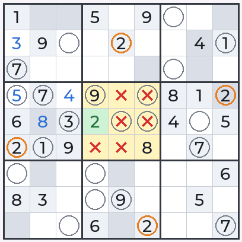

<!-- Written by tools/walkthrough.py even-odd: edit the script, not this page. -->
# Even-Odd, step 5: the 2 in box 5

**Step 5 of 51** · [← Step 4](step-04.md) · [All steps](../even-odd.md#the-whole-puzzle-step-by-step) · [Step 6 →](step-06.md)

Box 5 needs a 2. r4c5 and r4c6: row 4 has one (r4c9). r5c5: column 5 has one (r2c5). r5c6: column 6 has one (r9c6). r6c4 and r6c5: row 6 has one (r6c1). Only **r5c4** is left: **r5c4 = 2**.

**Step 5 of 51** · [← Step 4](step-04.md) · [All steps](../even-odd.md#the-whole-puzzle-step-by-step) · [Step 6 →](step-06.md)
