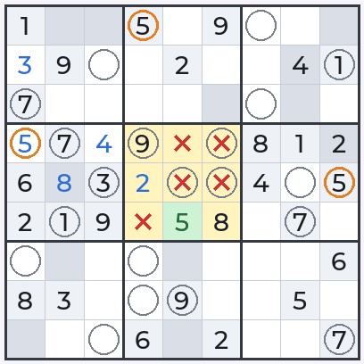

<!-- Written by tools/walkthrough.py even-odd: edit the script, not this page. -->
# Even-Odd, step 6: the 5 in box 5

**Step 6 of 51** · [← Step 5](step-05.md) · [All steps](../even-odd.md#the-whole-puzzle-step-by-step) · [Step 7 →](step-07.md)

Box 5 needs a 5. r4c5 and r4c6: row 4 has one (r4c1). r5c5 and r5c6: row 5 has one (r5c9). r6c4: column 4 has one (r1c4). Only **r6c5** is left: **r6c5 = 5**.

**Step 6 of 51** · [← Step 5](step-05.md) · [All steps](../even-odd.md#the-whole-puzzle-step-by-step) · [Step 7 →](step-07.md)
