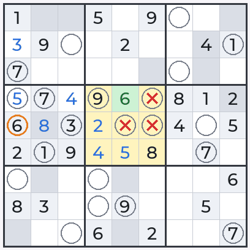

<!-- Written by tools/walkthrough.py even-odd: edit the script, not this page. -->
# Even-Odd, step 8: the 6 in box 5

**Step 8 of 51** · [← Step 7](step-07.md) · [All steps](../even-odd.md#the-whole-puzzle-step-by-step) · [Step 9 →](step-09.md)

Box 5 needs a 6. r4c6: ringed (odd), so not 6. r5c5 and r5c6: row 5 has one (r5c1). Only **r4c5** is left: **r4c5 = 6**.

**Step 8 of 51** · [← Step 7](step-07.md) · [All steps](../even-odd.md#the-whole-puzzle-step-by-step) · [Step 9 →](step-09.md)
