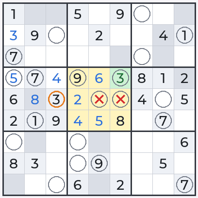

<!-- Written by tools/walkthrough.py even-odd: edit the script, not this page. -->
# Even-Odd, step 9: the 3 in box 5

**Step 9 of 51** · [← Step 8](step-08.md) · [All steps](../even-odd.md#the-whole-puzzle-step-by-step) · [Step 10 →](step-10.md)

Box 5 needs a 3. r5c5 and r5c6: row 5 has one (r5c3). Only **r4c6** is left: **r4c6 = 3**.

**Step 9 of 51** · [← Step 8](step-08.md) · [All steps](../even-odd.md#the-whole-puzzle-step-by-step) · [Step 10 →](step-10.md)
