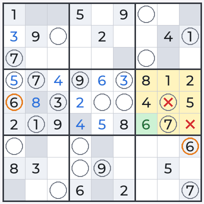

<!-- Written by tools/walkthrough.py even-odd: edit the script, not this page. -->
# Even-Odd, step 10: the 6 in box 6

**Step 10 of 51** · [← Step 9](step-09.md) · [All steps](../even-odd.md#the-whole-puzzle-step-by-step) · [Step 11 →](step-11.md)

Box 6 needs a 6. r5c8: row 5 has one (r5c1). r6c9: column 9 has one (r7c9). Only **r6c7** is left: **r6c7 = 6**.

**Step 10 of 51** · [← Step 9](step-09.md) · [All steps](../even-odd.md#the-whole-puzzle-step-by-step) · [Step 11 →](step-11.md)
