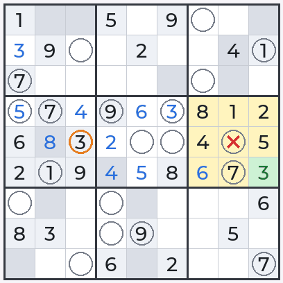

<!-- Written by tools/walkthrough.py even-odd: edit the script, not this page. -->
# Even-Odd, step 11: the 3 in box 6

**Step 11 of 51** · [← Step 10](step-10.md) · [All steps](../even-odd.md#the-whole-puzzle-step-by-step) · [Step 12 →](step-12.md)

Box 6 needs a 3. r5c8: row 5 has one (r5c3). Only **r6c9** is left: **r6c9 = 3**.

**Step 11 of 51** · [← Step 10](step-10.md) · [All steps](../even-odd.md#the-whole-puzzle-step-by-step) · [Step 12 →](step-12.md)
