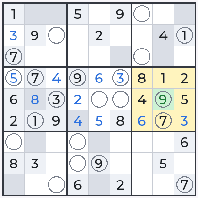

<!-- Written by tools/walkthrough.py even-odd: edit the script, not this page. -->
# Even-Odd, step 12: the 9 in box 6

**Step 12 of 51** · [← Step 11](step-11.md) · [All steps](../even-odd.md#the-whole-puzzle-step-by-step) · [Step 13 →](step-13.md)

Box 6 needs a 9, and r5c8 is its last empty cell: **r5c8 = 9**.

**Step 12 of 51** · [← Step 11](step-11.md) · [All steps](../even-odd.md#the-whole-puzzle-step-by-step) · [Step 13 →](step-13.md)
