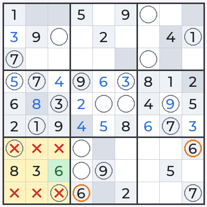

<!-- Written by tools/walkthrough.py even-odd: edit the script, not this page. -->
# Even-Odd, step 13: the 6 in box 7

**Step 13 of 51** · [← Step 12](step-12.md) · [All steps](../even-odd.md#the-whole-puzzle-step-by-step) · [Step 14 →](step-14.md)

Box 7 needs a 6. r7c1, r7c2 and r7c3: row 7 has one (r7c9). r9c1, r9c2 and r9c3: row 9 has one (r9c4). Only **r8c3** is left: **r8c3 = 6**.

**Step 13 of 51** · [← Step 12](step-12.md) · [All steps](../even-odd.md#the-whole-puzzle-step-by-step) · [Step 14 →](step-14.md)
