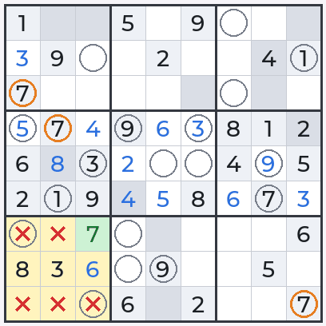

<!-- Written by tools/walkthrough.py even-odd: edit the script, not this page. -->
# Even-Odd, step 14: the 7 in box 7

**Step 14 of 51** · [← Step 13](step-13.md) · [All steps](../even-odd.md#the-whole-puzzle-step-by-step) · [Step 15 →](step-15.md)

Box 7 needs a 7. r7c1: column 1 has one (r3c1). r7c2: column 2 has one (r4c2). r9c1, r9c2 and r9c3: row 9 has one (r9c9). Only **r7c3** is left: **r7c3 = 7**.

**Step 14 of 51** · [← Step 13](step-13.md) · [All steps](../even-odd.md#the-whole-puzzle-step-by-step) · [Step 15 →](step-15.md)
