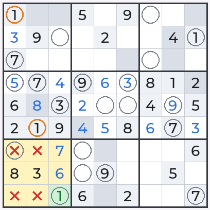

<!-- Written by tools/walkthrough.py even-odd: edit the script, not this page. -->
# Even-Odd, step 15: the 1 in box 7

**Step 15 of 51** · [← Step 14](step-14.md) · [All steps](../even-odd.md#the-whole-puzzle-step-by-step) · [Step 16 →](step-16.md)

Box 7 needs a 1. r7c1 and r9c1: column 1 has one (r1c1). r7c2 and r9c2: column 2 has one (r6c2). Only **r9c3** is left: **r9c3 = 1**.

**Step 15 of 51** · [← Step 14](step-14.md) · [All steps](../even-odd.md#the-whole-puzzle-step-by-step) · [Step 16 →](step-16.md)
