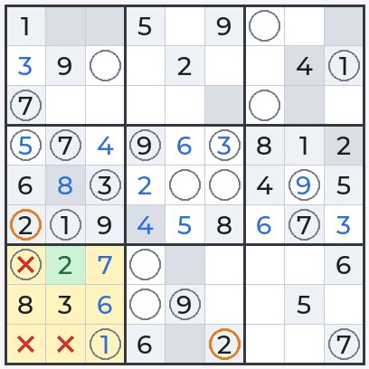

<!-- Written by tools/walkthrough.py even-odd: edit the script, not this page. -->
# Even-Odd, step 16: the 2 in box 7

**Step 16 of 51** · [← Step 15](step-15.md) · [All steps](../even-odd.md#the-whole-puzzle-step-by-step) · [Step 17 →](step-17.md)

Box 7 needs a 2. r7c1: column 1 has one (r6c1). r9c1 and r9c2: row 9 has one (r9c6). Only **r7c2** is left: **r7c2 = 2**.

**Step 16 of 51** · [← Step 15](step-15.md) · [All steps](../even-odd.md#the-whole-puzzle-step-by-step) · [Step 17 →](step-17.md)
