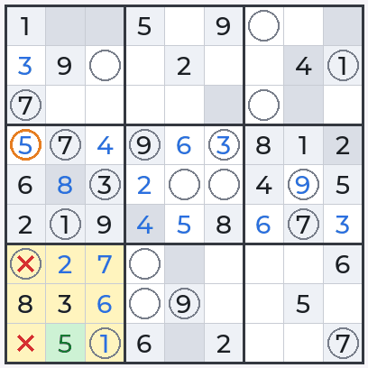

<!-- Written by tools/walkthrough.py even-odd: edit the script, not this page. -->
# Even-Odd, step 17: the 5 in box 7

**Step 17 of 51** · [← Step 16](step-16.md) · [All steps](../even-odd.md#the-whole-puzzle-step-by-step) · [Step 18 →](step-18.md)

Box 7 needs a 5. r7c1 and r9c1: column 1 has one (r4c1). Only **r9c2** is left: **r9c2 = 5**.

**Step 17 of 51** · [← Step 16](step-16.md) · [All steps](../even-odd.md#the-whole-puzzle-step-by-step) · [Step 18 →](step-18.md)
