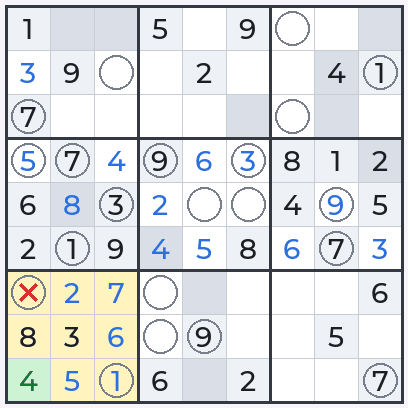

<!-- Written by tools/walkthrough.py even-odd: edit the script, not this page. -->
# Even-Odd, step 18: the 4 in box 7

**Step 18 of 51** · [← Step 17](step-17.md) · [All steps](../even-odd.md#the-whole-puzzle-step-by-step) · [Step 19 →](step-19.md)

Box 7 needs a 4. r7c1: ringed (odd), so not 4. Only **r9c1** is left: **r9c1 = 4**.

**Step 18 of 51** · [← Step 17](step-17.md) · [All steps](../even-odd.md#the-whole-puzzle-step-by-step) · [Step 19 →](step-19.md)
