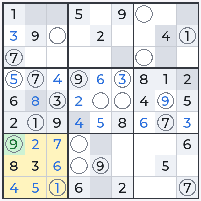

<!-- Written by tools/walkthrough.py even-odd: edit the script, not this page. -->
# Even-Odd, step 19: the 9 in box 7

**Step 19 of 51** · [← Step 18](step-18.md) · [All steps](../even-odd.md#the-whole-puzzle-step-by-step) · [Step 20 →](step-20.md)

Box 7 needs a 9, and r7c1 is its last empty cell: **r7c1 = 9**.

**Step 19 of 51** · [← Step 18](step-18.md) · [All steps](../even-odd.md#the-whole-puzzle-step-by-step) · [Step 20 →](step-20.md)
