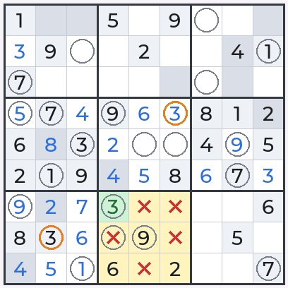

<!-- Written by tools/walkthrough.py even-odd: edit the script, not this page. -->
# Even-Odd, step 20: the 3 in box 8

**Step 20 of 51** · [← Step 19](step-19.md) · [All steps](../even-odd.md#the-whole-puzzle-step-by-step) · [Step 21 →](step-21.md)

Box 8 needs a 3. r7c5 and r9c5: shaded (even), so not 3. r7c6: column 6 has one (r4c6). r8c4 and r8c6: row 8 has one (r8c2). Only **r7c4** is left: **r7c4 = 3**.

**Step 20 of 51** · [← Step 19](step-19.md) · [All steps](../even-odd.md#the-whole-puzzle-step-by-step) · [Step 21 →](step-21.md)
