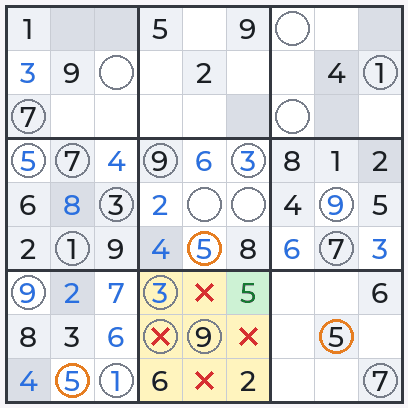

<!-- Written by tools/walkthrough.py even-odd: edit the script, not this page. -->
# Even-Odd, step 21: the 5 in box 8

**Step 21 of 51** · [← Step 20](step-20.md) · [All steps](../even-odd.md#the-whole-puzzle-step-by-step) · [Step 22 →](step-22.md)

Box 8 needs a 5. r7c5: column 5 has one (r6c5). r8c4 and r8c6: row 8 has one (r8c8). r9c5: row 9 has one (r9c2). Only **r7c6** is left: **r7c6 = 5**.

**Step 21 of 51** · [← Step 20](step-20.md) · [All steps](../even-odd.md#the-whole-puzzle-step-by-step) · [Step 22 →](step-22.md)
