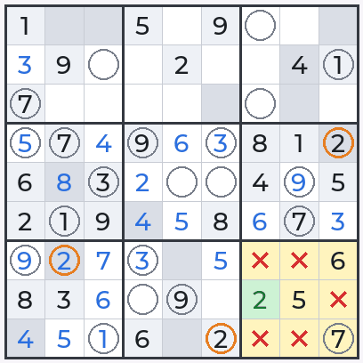

<!-- Written by tools/walkthrough.py even-odd: edit the script, not this page. -->
# Even-Odd, step 22: the 2 in box 9

**Step 22 of 51** · [← Step 21](step-21.md) · [All steps](../even-odd.md#the-whole-puzzle-step-by-step) · [Step 23 →](step-23.md)

Box 9 needs a 2. r7c7 and r7c8: row 7 has one (r7c2). r8c9: column 9 has one (r4c9). r9c7 and r9c8: row 9 has one (r9c6). Only **r8c7** is left: **r8c7 = 2**.

**Step 22 of 51** · [← Step 21](step-21.md) · [All steps](../even-odd.md#the-whole-puzzle-step-by-step) · [Step 23 →](step-23.md)
