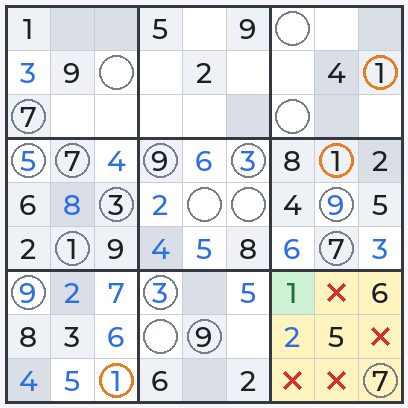

<!-- Written by tools/walkthrough.py even-odd: edit the script, not this page. -->
# Even-Odd, step 23: the 1 in box 9

**Step 23 of 51** · [← Step 22](step-22.md) · [All steps](../even-odd.md#the-whole-puzzle-step-by-step) · [Step 24 →](step-24.md)

Box 9 needs a 1. r7c8: column 8 has one (r4c8). r8c9: column 9 has one (r2c9). r9c7 and r9c8: row 9 has one (r9c3). Only **r7c7** is left: **r7c7 = 1**.

**Step 23 of 51** · [← Step 22](step-22.md) · [All steps](../even-odd.md#the-whole-puzzle-step-by-step) · [Step 24 →](step-24.md)
