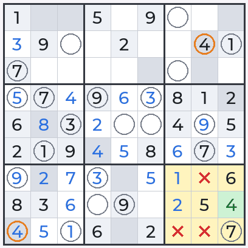

<!-- Written by tools/walkthrough.py even-odd: edit the script, not this page. -->
# Even-Odd, step 24: the 4 in box 9

**Step 24 of 51** · [← Step 23](step-23.md) · [All steps](../even-odd.md#the-whole-puzzle-step-by-step) · [Step 25 →](step-25.md)

Box 9 needs a 4. r7c8: column 8 has one (r2c8). r9c7 and r9c8: row 9 has one (r9c1). Only **r8c9** is left: **r8c9 = 4**.

**Step 24 of 51** · [← Step 23](step-23.md) · [All steps](../even-odd.md#the-whole-puzzle-step-by-step) · [Step 25 →](step-25.md)
