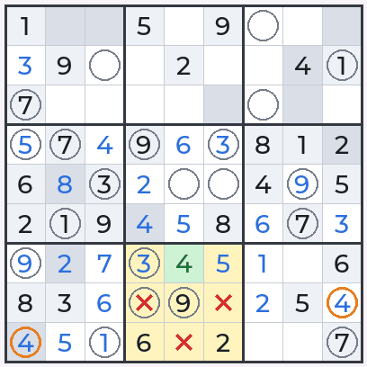

<!-- Written by tools/walkthrough.py even-odd: edit the script, not this page. -->
# Even-Odd, step 25: the 4 in box 8

**Step 25 of 51** · [← Step 24](step-24.md) · [All steps](../even-odd.md#the-whole-puzzle-step-by-step) · [Step 26 →](step-26.md)

Box 8 needs a 4. r8c4 and r8c6: row 8 has one (r8c9). r9c5: row 9 has one (r9c1). Only **r7c5** is left: **r7c5 = 4**.

**Step 25 of 51** · [← Step 24](step-24.md) · [All steps](../even-odd.md#the-whole-puzzle-step-by-step) · [Step 26 →](step-26.md)
