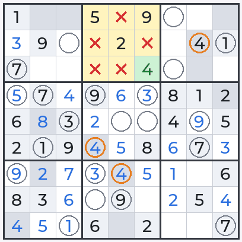

<!-- Written by tools/walkthrough.py even-odd: edit the script, not this page. -->
# Even-Odd, step 26: the 4 in box 2

**Step 26 of 51** · [← Step 25](step-25.md) · [All steps](../even-odd.md#the-whole-puzzle-step-by-step) · [Step 27 →](step-27.md)

Box 2 needs a 4. r1c5 and r3c5: column 5 has one (r7c5). r2c4 and r2c6: row 2 has one (r2c8). r3c4: column 4 has one (r6c4). Only **r3c6** is left: **r3c6 = 4**.

**Step 26 of 51** · [← Step 25](step-25.md) · [All steps](../even-odd.md#the-whole-puzzle-step-by-step) · [Step 27 →](step-27.md)
