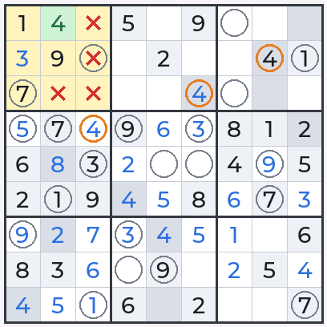

<!-- Written by tools/walkthrough.py even-odd: edit the script, not this page. -->
# Even-Odd, step 27: the 4 in box 1

**Step 27 of 51** · [← Step 26](step-26.md) · [All steps](../even-odd.md#the-whole-puzzle-step-by-step) · [Step 28 →](step-28.md)

Box 1 needs a 4. r1c3: column 3 has one (r4c3). r2c3: row 2 has one (r2c8). r3c2 and r3c3: row 3 has one (r3c6). Only **r1c2** is left: **r1c2 = 4**.

**Step 27 of 51** · [← Step 26](step-26.md) · [All steps](../even-odd.md#the-whole-puzzle-step-by-step) · [Step 28 →](step-28.md)
