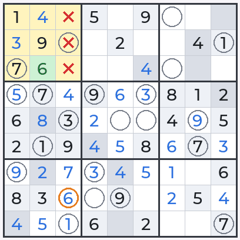

<!-- Written by tools/walkthrough.py even-odd: edit the script, not this page. -->
# Even-Odd, step 28: the 6 in box 1

**Step 28 of 51** · [← Step 27](step-27.md) · [All steps](../even-odd.md#the-whole-puzzle-step-by-step) · [Step 29 →](step-29.md)

Box 1 needs a 6. r1c3, r2c3 and r3c3: column 3 has one (r8c3). Only **r3c2** is left: **r3c2 = 6**.

**Step 28 of 51** · [← Step 27](step-27.md) · [All steps](../even-odd.md#the-whole-puzzle-step-by-step) · [Step 29 →](step-29.md)
