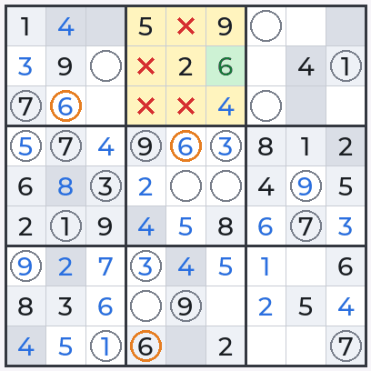

<!-- Written by tools/walkthrough.py even-odd: edit the script, not this page. -->
# Even-Odd, step 29: the 6 in box 2

**Step 29 of 51** · [← Step 28](step-28.md) · [All steps](../even-odd.md#the-whole-puzzle-step-by-step) · [Step 30 →](step-30.md)

Box 2 needs a 6. r1c5: column 5 has one (r4c5). r2c4: column 4 has one (r9c4). r3c4 and r3c5: row 3 has one (r3c2). Only **r2c6** is left: **r2c6 = 6**.

**Step 29 of 51** · [← Step 28](step-28.md) · [All steps](../even-odd.md#the-whole-puzzle-step-by-step) · [Step 30 →](step-30.md)
