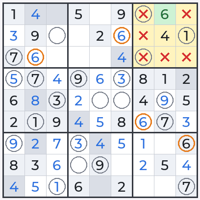

<!-- Written by tools/walkthrough.py even-odd: edit the script, not this page. -->
# Even-Odd, step 30: the 6 in box 3

**Step 30 of 51** · [← Step 29](step-29.md) · [All steps](../even-odd.md#the-whole-puzzle-step-by-step) · [Step 31 →](step-31.md)

Box 3 needs a 6. r1c7: column 7 has one (r6c7). r1c9: column 9 has one (r7c9). r2c7: row 2 has one (r2c6). r3c7, r3c8 and r3c9: row 3 has one (r3c2). Only **r1c8** is left: **r1c8 = 6**.

**Step 30 of 51** · [← Step 29](step-29.md) · [All steps](../even-odd.md#the-whole-puzzle-step-by-step) · [Step 31 →](step-31.md)
