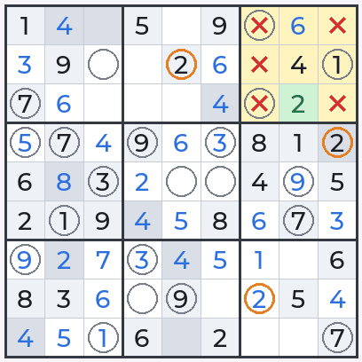

<!-- Written by tools/walkthrough.py even-odd: edit the script, not this page. -->
# Even-Odd, step 31: the 2 in box 3

**Step 31 of 51** · [← Step 30](step-30.md) · [All steps](../even-odd.md#the-whole-puzzle-step-by-step) · [Step 32 →](step-32.md)

Box 3 needs a 2. r1c7 and r3c7: column 7 has one (r8c7). r1c9 and r3c9: column 9 has one (r4c9). r2c7: row 2 has one (r2c5). Only **r3c8** is left: **r3c8 = 2**.

**Step 31 of 51** · [← Step 30](step-30.md) · [All steps](../even-odd.md#the-whole-puzzle-step-by-step) · [Step 32 →](step-32.md)
