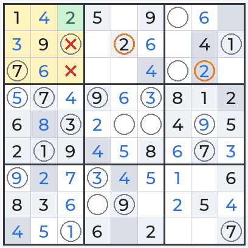

<!-- Written by tools/walkthrough.py even-odd: edit the script, not this page. -->
# Even-Odd, step 32: the 2 in box 1

**Step 32 of 51** · [← Step 31](step-31.md) · [All steps](../even-odd.md#the-whole-puzzle-step-by-step) · [Step 33 →](step-33.md)

Box 1 needs a 2. r2c3: row 2 has one (r2c5). r3c3: row 3 has one (r3c8). Only **r1c3** is left: **r1c3 = 2**.

**Step 32 of 51** · [← Step 31](step-31.md) · [All steps](../even-odd.md#the-whole-puzzle-step-by-step) · [Step 33 →](step-33.md)
