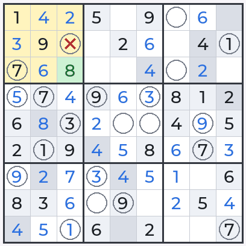

<!-- Written by tools/walkthrough.py even-odd: edit the script, not this page. -->
# Even-Odd, step 33: the 8 in box 1

**Step 33 of 51** · [← Step 32](step-32.md) · [All steps](../even-odd.md#the-whole-puzzle-step-by-step) · [Step 34 →](step-34.md)

Box 1 needs an 8. r2c3: ringed (odd), so not 8. Only **r3c3** is left: **r3c3 = 8**.

**Step 33 of 51** · [← Step 32](step-32.md) · [All steps](../even-odd.md#the-whole-puzzle-step-by-step) · [Step 34 →](step-34.md)
