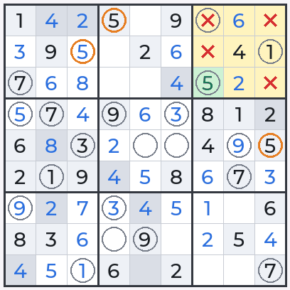

<!-- Written by tools/walkthrough.py even-odd: edit the script, not this page. -->
# Even-Odd, step 35: the 5 in box 3

**Step 35 of 51** · [← Step 34](step-34.md) · [All steps](../even-odd.md#the-whole-puzzle-step-by-step) · [Step 36 →](step-36.md)

Box 3 needs a 5. r1c7 and r1c9: row 1 has one (r1c4). r2c7: row 2 has one (r2c3). r3c9: column 9 has one (r5c9). Only **r3c7** is left: **r3c7 = 5**.

**Step 35 of 51** · [← Step 34](step-34.md) · [All steps](../even-odd.md#the-whole-puzzle-step-by-step) · [Step 36 →](step-36.md)
