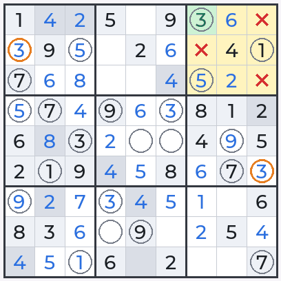

<!-- Written by tools/walkthrough.py even-odd: edit the script, not this page. -->
# Even-Odd, step 36: the 3 in box 3

**Step 36 of 51** · [← Step 35](step-35.md) · [All steps](../even-odd.md#the-whole-puzzle-step-by-step) · [Step 37 →](step-37.md)

Box 3 needs a 3. r1c9 and r3c9: column 9 has one (r6c9). r2c7: row 2 has one (r2c1). Only **r1c7** is left: **r1c7 = 3**.

**Step 36 of 51** · [← Step 35](step-35.md) · [All steps](../even-odd.md#the-whole-puzzle-step-by-step) · [Step 37 →](step-37.md)
