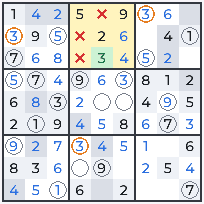

<!-- Written by tools/walkthrough.py even-odd: edit the script, not this page. -->
# Even-Odd, step 37: the 3 in box 2

**Step 37 of 51** · [← Step 36](step-36.md) · [All steps](../even-odd.md#the-whole-puzzle-step-by-step) · [Step 38 →](step-38.md)

Box 2 needs a 3. r1c5: row 1 has one (r1c7). r2c4: row 2 has one (r2c1). r3c4: column 4 has one (r7c4). Only **r3c5** is left: **r3c5 = 3**.

**Step 37 of 51** · [← Step 36](step-36.md) · [All steps](../even-odd.md#the-whole-puzzle-step-by-step) · [Step 38 →](step-38.md)
