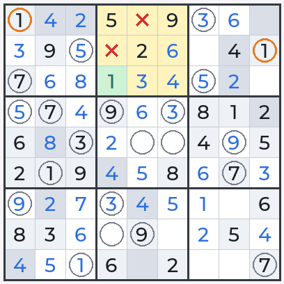

<!-- Written by tools/walkthrough.py even-odd: edit the script, not this page. -->
# Even-Odd, step 38: the 1 in box 2

**Step 38 of 51** · [← Step 37](step-37.md) · [All steps](../even-odd.md#the-whole-puzzle-step-by-step) · [Step 39 →](step-39.md)

Box 2 needs a 1. r1c5: row 1 has one (r1c1). r2c4: row 2 has one (r2c9). Only **r3c4** is left: **r3c4 = 1**.

**Step 38 of 51** · [← Step 37](step-37.md) · [All steps](../even-odd.md#the-whole-puzzle-step-by-step) · [Step 39 →](step-39.md)
