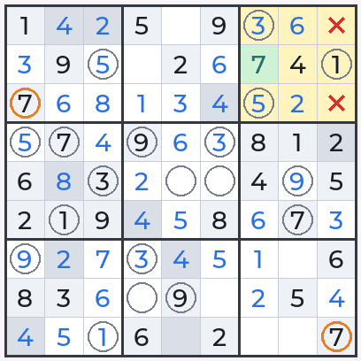

<!-- Written by tools/walkthrough.py even-odd: edit the script, not this page. -->
# Even-Odd, step 39: the 7 in box 3

**Step 39 of 51** · [← Step 38](step-38.md) · [All steps](../even-odd.md#the-whole-puzzle-step-by-step) · [Step 40 →](step-40.md)

Box 3 needs a 7. r1c9: column 9 has one (r9c9). r3c9: row 3 has one (r3c1). Only **r2c7** is left: **r2c7 = 7**.

**Step 39 of 51** · [← Step 38](step-38.md) · [All steps](../even-odd.md#the-whole-puzzle-step-by-step) · [Step 40 →](step-40.md)
