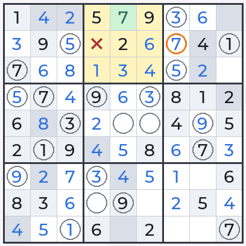

<!-- Written by tools/walkthrough.py even-odd: edit the script, not this page. -->
# Even-Odd, step 40: the 7 in box 2

**Step 40 of 51** · [← Step 39](step-39.md) · [All steps](../even-odd.md#the-whole-puzzle-step-by-step) · [Step 41 →](step-41.md)

Box 2 needs a 7. r2c4: row 2 has one (r2c7). Only **r1c5** is left: **r1c5 = 7**.

**Step 40 of 51** · [← Step 39](step-39.md) · [All steps](../even-odd.md#the-whole-puzzle-step-by-step) · [Step 41 →](step-41.md)
