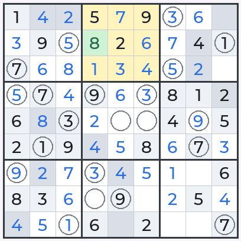

<!-- Written by tools/walkthrough.py even-odd: edit the script, not this page. -->
# Even-Odd, step 41: the 8 in box 2

**Step 41 of 51** · [← Step 40](step-40.md) · [All steps](../even-odd.md#the-whole-puzzle-step-by-step) · [Step 42 →](step-42.md)

Box 2 needs an 8, and r2c4 is its last empty cell: **r2c4 = 8**.

**Step 41 of 51** · [← Step 40](step-40.md) · [All steps](../even-odd.md#the-whole-puzzle-step-by-step) · [Step 42 →](step-42.md)
