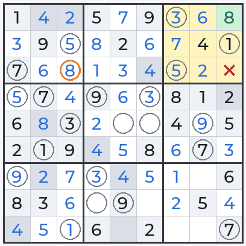

<!-- Written by tools/walkthrough.py even-odd: edit the script, not this page. -->
# Even-Odd, step 42: the 8 in box 3

**Step 42 of 51** · [← Step 41](step-41.md) · [All steps](../even-odd.md#the-whole-puzzle-step-by-step) · [Step 43 →](step-43.md)

Box 3 needs an 8. r3c9: row 3 has one (r3c3). Only **r1c9** is left: **r1c9 = 8**.

**Step 42 of 51** · [← Step 41](step-41.md) · [All steps](../even-odd.md#the-whole-puzzle-step-by-step) · [Step 43 →](step-43.md)
