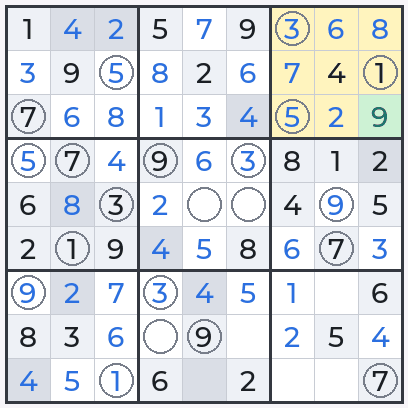

<!-- Written by tools/walkthrough.py even-odd: edit the script, not this page. -->
# Even-Odd, step 43: the 9 in box 3

**Step 43 of 51** · [← Step 42](step-42.md) · [All steps](../even-odd.md#the-whole-puzzle-step-by-step) · [Step 44 →](step-44.md)

Box 3 needs a 9, and r3c9 is its last empty cell: **r3c9 = 9**.

**Step 43 of 51** · [← Step 42](step-42.md) · [All steps](../even-odd.md#the-whole-puzzle-step-by-step) · [Step 44 →](step-44.md)
