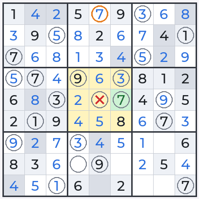

<!-- Written by tools/walkthrough.py even-odd: edit the script, not this page. -->
# Even-Odd, step 44: the 7 in box 5

**Step 44 of 51** · [← Step 43](step-43.md) · [All steps](../even-odd.md#the-whole-puzzle-step-by-step) · [Step 45 →](step-45.md)

Box 5 needs a 7. r5c5: column 5 has one (r1c5). Only **r5c6** is left: **r5c6 = 7**.

**Step 44 of 51** · [← Step 43](step-43.md) · [All steps](../even-odd.md#the-whole-puzzle-step-by-step) · [Step 45 →](step-45.md)
