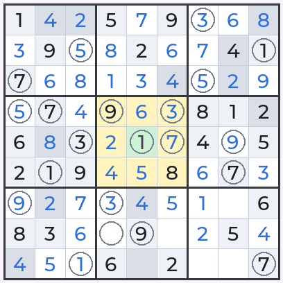

<!-- Written by tools/walkthrough.py even-odd: edit the script, not this page. -->
# Even-Odd, step 45: the 1 in box 5

**Step 45 of 51** · [← Step 44](step-44.md) · [All steps](../even-odd.md#the-whole-puzzle-step-by-step) · [Step 46 →](step-46.md)

Box 5 needs a 1, and r5c5 is its last empty cell: **r5c5 = 1**.

**Step 45 of 51** · [← Step 44](step-44.md) · [All steps](../even-odd.md#the-whole-puzzle-step-by-step) · [Step 46 →](step-46.md)
